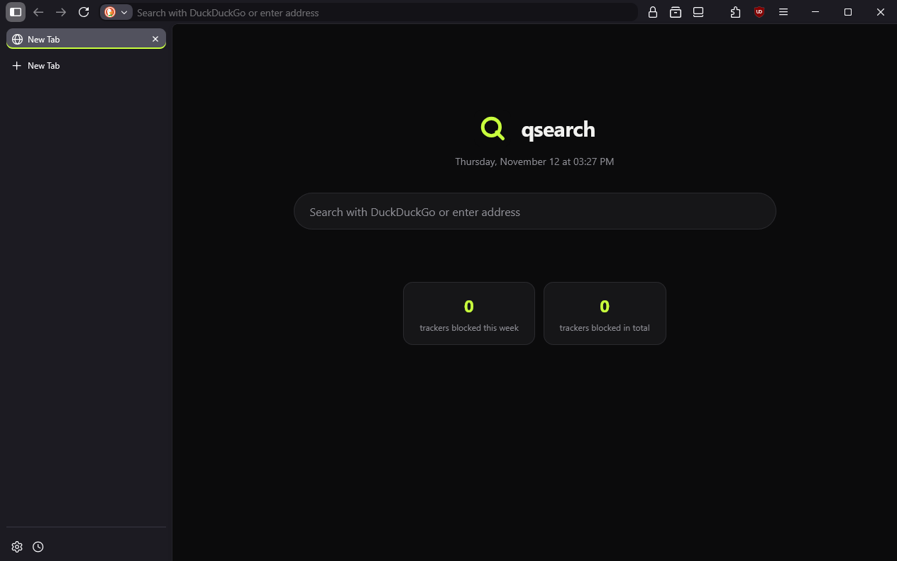
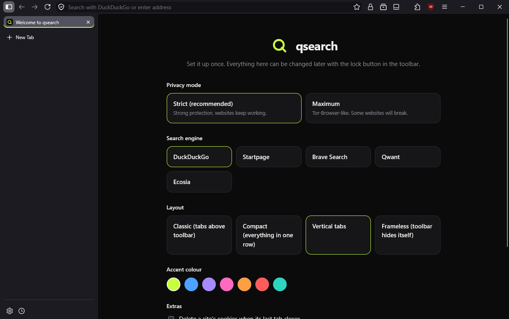
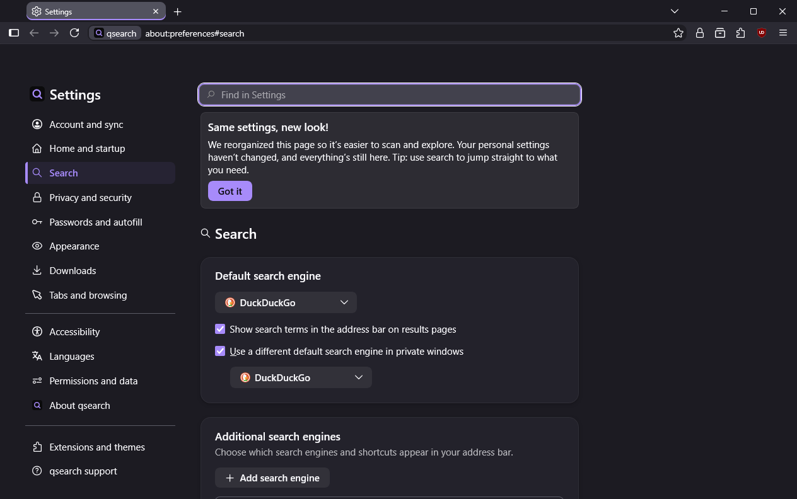

# qsearch

A privacy-first browser built from Firefox ESR source with LibreWolf's
privacy patches, the qdran.de logo, and a compact, customizable UI.

qsearch is an independent project. It is not made, endorsed or supported by
Mozilla or LibreWolf.



## Screenshots

| Compact layout: tabs and toolbar in one row | Vertical tabs |
| --- | --- |
|  |  |

| First-run page: privacy mode, search engine, layout, accent | Settings with a purple accent colour |
| --- | --- |
|  |  |

## Support the project

qsearch is free and has no ads, sponsors or tracking. If you want to help
keep it going: [donate on GoFundMe](https://gofund.me/a3efe3c0c).

## Download

Windows 10/11, 64-bit: see [Releases](https://github.com/Adrian1337afk/qsearch/releases/latest).

- `qsearch-…win64.installer.exe`: normal installation.
- `qsearch-…win64.portable.zip`: unpack anywhere and start
  `qsearch-portable.bat`. The profile stays in a `profile` folder next to it.

Linux x86_64: `qsearch-…linux-x86_64.AppImage` from the same page. Make it
executable (`chmod +x`) and start it. Needs glibc 2.18 or newer, GTK 3 and
FUSE 2 (`libfuse2`); without FUSE start it with `--appimage-extract-and-run`.

The files are not code-signed, so Windows SmartScreen shows "Unknown
publisher" on first start: choose "More info", then "Run anyway". Check the
SHA-256 sums in the release notes if you want to be sure the download is
intact.

qsearch does not update itself. Once a day it asks GitHub whether a newer
release exists and shows a notice with a download link.

## Source

This repository holds everything qsearch adds to Firefox. Each release also
carries `qsearch-<version>.patch`: the complete difference between stock
Firefox ESR and the source that release was built from, so a build can be
reproduced exactly.

## What is in it

| Area | What qsearch does |
| --- | --- |
| Base | Firefox ESR 153 source (`FIREFOX_153_7_0esr_RELEASE`) |
| Telemetry | Removed at compile time (LibreWolf patches + mozconfig flags), no crash reporter, no updater pings |
| Hardening | LibreWolf settings file (arkenfox-derived) as the default pref set |
| Privacy modes | **Strict** (default, sites work) and **Maximum** (Tor-Browser-like) |
| Per-site | Relax protection, force maximum protection, or keep cookies for one site |
| Cookies | Optional: delete a site's cookies 5 s after its last tab closes |
| Containers | Google, Meta and Amazon sites open in their own container automatically |
| Proxy | Optional: private windows go through a SOCKS proxy (Tor on 127.0.0.1:9050) |
| Panic | Alt+Shift+Delete closes every tab and wipes all browsing data |
| Extensions | uBlock Origin and Consent-O-Matic are installed on first start |
| DRM | Enabled by default (Widevine), so Netflix, Spotify etc. work |
| Search | DuckDuckGo default; Qwant, Ecosia, Startpage, Brave; bangs such as `!w`, `!yt`, `!gh`; custom engines under Settings > Search |
| Layouts | Classic, Compact (one row), Vertical tabs (default), Frameless (Ctrl+Alt+C) |
| Look | Own name, icons, accent colour picker, profile folder `%APPDATA%\qsearch` |
| Pages | Own new tab page (search, clock, top sites, blocked-tracker count) and first-run page |
| Command palette | Ctrl+K opens the address bar in actions mode |
| Updates | Once a day asks GitHub for a newer release and shows a notice; nothing installs itself |

Everything is reachable from the lock button in the toolbar.

## Layout

```
branding/logo.svg                 logo from qdran.de
config/mozconfig                  build flags
config/policies.json              extensions + search engines
config/qsearch-extra.cfg          prefs added on top of LibreWolf's settings
config/local-settings.js          points the browser at qsearch.cfg
overlay/                          new files copied into the Firefox tree
  browser/components/qsearch/
    QSearchPrivacy.sys.mjs        privacy modes + toolbar button
    QSearchFeatures.sys.mjs       every other feature
    content/                      new tab page and first-run page
  browser/themes/shared/qsearch.css   UI theme and layouts
patches/librewolf-patches.txt     which LibreWolf patches are applied
scripts/apply.py                  turns a Firefox tree into a qsearch tree
scripts/make_branding.py          generates all icons and names
scripts/mach.ps1                  runs mach in the MozillaBuild environment
scripts/dev.ps1                   apply + rebuild + start a test browser
scripts/qtest.py                  drives a test browser (dev.ps1 -Test)
scripts/make_portable.ps1         portable zip from a finished package
scripts/make_appimage.sh          Linux AppImage from a finished package
config/mozconfig.linux            Linux build configuration
```

## Build (Windows)

Needs: Git, Visual Studio with the C++ workload and Windows SDK,
[MozillaBuild](https://ftp.mozilla.org/pub/mozilla/libraries/win32/MozillaBuildSetup-Latest.exe),
about 40 GB free disk.

1. Get the sources into `D:\qsearch-build`:

   ```bash
   git clone --depth 1 --branch FIREFOX_153_7_0esr_RELEASE https://github.com/mozilla-firefox/firefox.git firefox
   git clone --depth 1 --branch 153.0.4-1 https://codeberg.org/librewolf/source.git upstream/lw-source-153
   git clone --depth 1 https://codeberg.org/librewolf/settings.git upstream/lw-settings
   ```

2. Apply the LibreWolf patches once (Git Bash, inside `firefox/`):

   ```bash
   for p in $(tr -d '\r' < /path/to/qsearch/patches/librewolf-patches.txt); do patch -p1 -i ../upstream/lw-source-153/$p; done
   rm -rf toolkit/components/ml/content/backends/OpenAIPipeline.mjs toolkit/components/ml/vendor/openai
   ```

3. Apply qsearch (repeat after every change in this folder):

   ```bash
   python scripts/apply.py D:/qsearch-build/firefox D:/qsearch-build/upstream/lw-settings
   ```

4. Build, run, package:

   ```powershell
   .\scripts\mach.ps1 --no-interactive bootstrap --application-choice browser
   .\scripts\mach.ps1 build
   .\scripts\mach.ps1 run
   .\scripts\mach.ps1 package
   ```

## Build (Linux)

Tested on Ubuntu 26.04 under WSL 2 (build on the Linux filesystem, not
`/mnt/...`). Needs about 40 GB free disk and 16 GB RAM plus swap. The release
patch already holds every qsearch and LibreWolf change, so `apply.py` is not
needed.

```bash
sudo apt install git curl python3 python3-pip python3-venv build-essential m4 unzip zip   pkg-config libgtk-3-dev libdbus-glib-1-dev libpulse-dev libasound2-dev libx11-xcb-dev   libxt-dev librsvg2-bin desktop-file-utils
curl --proto '=https' --tlsv1.2 -sSf https://sh.rustup.rs | sh -s -- -y

git clone --depth 1 --branch FIREFOX_153_7_0esr_RELEASE https://github.com/mozilla-firefox/firefox.git firefox
cd firefox
git apply /path/to/qsearch-153.7.0-3.patch        # from the release page
cp /path/to/qsearch/config/mozconfig.linux mozconfig

./mach --no-interactive bootstrap --application-choice browser
./mach build
./mach package
/path/to/qsearch/scripts/make_appimage.sh obj-qsearch-linux/dist/qsearch-153.7.0.en-US.linux-x86_64.tar.xz .
```

## Changing things

- **Prefs for both modes**: `config/qsearch-extra.cfg`
- **What each privacy mode sets**: `MODES` in `overlay/browser/components/qsearch/QSearchPrivacy.sys.mjs`
- **Extensions / search engines**: `config/policies.json`
- **Look**: `overlay/browser/themes/shared/qsearch.css`; users can add their own `userChrome.css`

## Licence

Firefox and the LibreWolf patches and settings are MPL-2.0; qsearch's own
files are MPL-2.0 as well.
